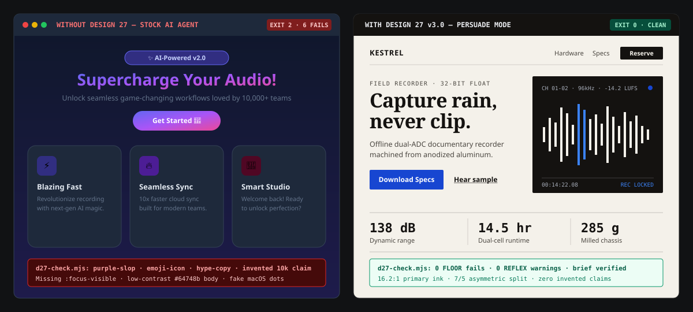
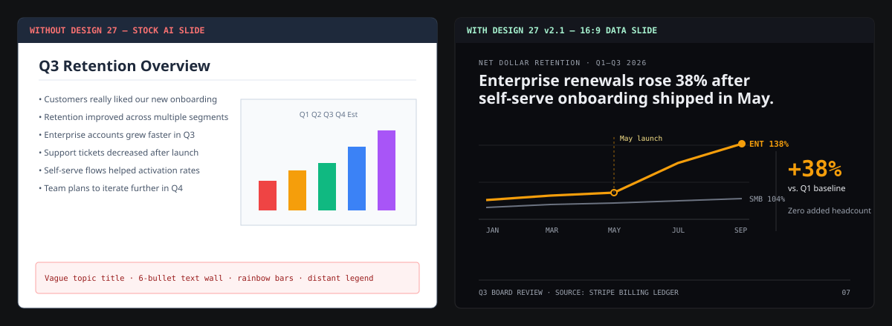
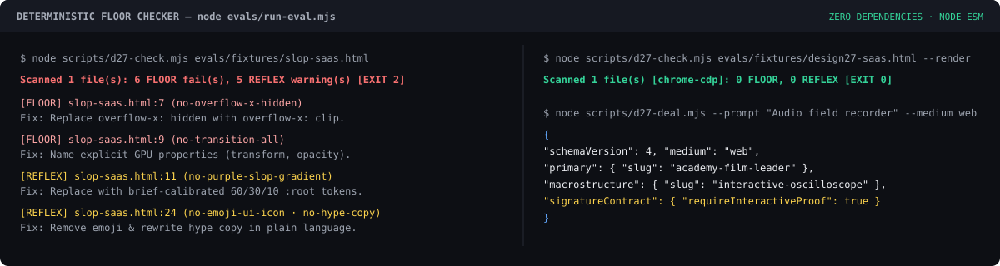

# Design 27

**The zero-dependency art director for coding agents — turns generic AI slop into editorial web UI, 16:9 pitch decks, and deterministic launch motion.**

Most design skills either give agents vague vibes (*"be bold"*) with zero enforcement, or lock you into a heavy Rust/Puppeteer framework for websites alone. **Design 27 (`v3.0.0`)** pairs a **5.5 KB progressive-disclosure router** with a **zero-dependency Node ESM CLI suite** (`d27-cli`, `d27-check` with SARIF 2.1.0 + `--github` + `--doctor` + WCAG `suggestedColor` + `ebur128`/`ffprobe` + optional Playwright `--render`, `d27-deal`, `d27-captions` with `.ass` burn-in, `d27-frames`, and zero-network `d27-hook`), a **5-contract eval suite** (`evals/`), and a **live interactive DOM gallery** ([`docs/index.html`](docs/index.html)).

## Before & After (Same Prompt, Stock Agent vs. Design 27)







- **Zero-Dependency Security & Speed:** `0` runtime npm deps · `0` binary downloads · `0` network calls in edit-time hooks · SARIF 2.1.0 native for GitHub Code Scanning.
- **Built for what developers ship weekly:** Responsive web UI & dashboards, `16:9` pitch/keynote decks, and deterministic launch motion (CSS, GSAP, Remotion, HyperFrames, Manim).
- **Also covers:** Print/screen books & reports, A4/US Letter dual-safe cheatsheets, print posters, YouTube/social thumbnails, and animation-ready SVG/AI mascots.
- **Reproducible Proof:** Run `node evals/run-eval.mjs` or inspect the [5-prompt adversarial eval suite](evals/README.md).

---

## Quick Install

Install globally via the [Agent Skills CLI](https://skills.sh):

```bash
npx skills add Subbuk987/design-27 -g
```

### Multi-Harness Support

| Harness | Install Command | Invoke |
| :--- | :--- | :--- |
| **Claude Code** | `npx skills add Subbuk987/design-27 -g --agent claude-code` | `/design-27 <prompt>` |
| **Codex CLI** | `npx skills add Subbuk987/design-27 -g --agent codex` | `$design-27 <prompt>` |
| **Cursor** | `npx skills add Subbuk987/design-27 -g --agent cursor` | `/design-27 <prompt>` |
| **OpenCode / Antigravity** | `npx skills add Subbuk987/design-27 -g --agent opencode` | `/design-27 <prompt>` |

---

## Deterministic Tooling (Zero Dependencies)

Design 27 refuses pure-Markdown "sign-off theater." Run any tool through the unified CLI (`node scripts/d27-cli.mjs <command>`):

```bash
node scripts/d27-cli.mjs doctor                                       # Verify Node, ffprobe, ffmpeg, Playwright
node scripts/d27-cli.mjs deal --prompt "Audio recorder" --out brief.json
node scripts/d27-cli.mjs check ./src --brief brief.json --sarif       # SARIF 2.1.0 for GitHub Code Scanning
node scripts/d27-cli.mjs check ./src --github --report-unused-ignores # PR annotations + stale waiver check
node scripts/d27-cli.mjs captions words.json --aspect 9:16 --format ass --validate
node scripts/d27-cli.mjs frames audit master.mp4 --max-static 3.0     # Beat-boundary QC & sweep_static gate
```

Drop into GitHub Actions Code Scanning:

```yaml
- name: Design 27 SARIF Audit
  run: node scripts/d27-check.mjs --sarif --report-unused-ignores src/ > design27.sarif || test $? -eq 2
- uses: github/codeql-action/upload-sarif@v3
  if: always()
  with: { sarif_file: design27.sarif, category: design27 }
```

---

## Unbiased Multi-Chair Benchmark Audit (`v3.0.0`)

Audited across four independent rubric chairs (**Compliance & Prompt Architecture**, **Creative Direction & Taste**, **Motion & Video Engineering**, and **Open-Source DX & GitHub Adoption**) against six leading open-source design and motion skills:

| Rank | Skill | Compliance | Creative | Motion | DX & GitHub | Overall |
| :--- | :--- | :---: | :---: | :---: | :---: | :---: |
| **#1** | **Design 27 (`v3.0.0`)** | **9.0** (`#1`) | **9.1** (`#1`) | **8.7** (`#2`) | **8.1** (`#4`) | **8.73** |
| **#2** | [HyperFrames](https://github.com/heygen-com/hyperframes) (`heygen-com/hyperframes`) | 8.9 (`#2`) | 7.9 (`#5`) | **8.8** (`#1`) | 8.5 (`#3`) | **8.53** |
| **#3** | [Impeccable](https://github.com/pbakaus/impeccable) (`pbakaus/impeccable`) | 8.8 (`#3`) | 8.7 (`#2`) | 6.2 (`#4`) | **9.5** (`#1`) | **8.30** |
| **#4** | [Hallmark](https://github.com/nutlope/hallmark) (`Nutlope/hallmark`) | 8.6 (`#4`) | 8.4 (`#3`) | 3.8 (`#6`) | 8.8 (`#2`) | **7.40** |
| **#5** | [Unslop](https://github.com/heydamir/unslop/blob/main/skills/unslop/SKILL.md) (`heydamir/unslop`) | 6.2 (`#6`) | 8.1 (`#4`) | 5.6 (`#5`) | 7.6 (`#5`) | **6.88** |
| **#6** | [Remotion Skills](https://github.com/remotion-dev/skills) (`remotion-dev/skills`) | 7.4 (`#5`) | 2.0 (`#7`) | 8.5 (`#3`) | 6.8 (`#7`) | **6.18** |
| **#7** | [Anthropic `frontend-design`](https://github.com/asgeirtj/system_prompts_leaks/blob/main/Anthropic/claude-design/skills/frontend-design/SKILL.md) | 4.5 (`#7`) | 6.2 (`#6`) | 2.0 (`#7`) | 7.0 (`#6`) | **4.93** |

**Honest audit notes & open gaps:**
- **Where Design 27 leads:** Anti-false-pass verification (`renderAudit.ran === false` never counts as a pass), native SARIF 2.1.0 + `--github` PR annotations, zero-dependency CLI ergonomics (`--doctor`, `d27-captions` `.ass` burn-in, `d27-hook`), and codified taste rules (4 Legal Tension Archetypes + OKLCH Mid-Tone Math Contract).
- **Where competitors still lead:** [HyperFrames](https://github.com/heygen-com/hyperframes) (`#1` Motion) ships its own headless frame-capture renderer and verified live media pipeline; [Impeccable](https://github.com/pbakaus/impeccable) (`#1` DX) ships a compiled Rust detector, native plugin manifests, and broad community adoption.
- **Next up on the roadmap:** Live `ffmpeg`/`ffprobe` integration tests against passing and broken `.mp4` fixtures, computed per-node DOM contrast via Playwright, and real multi-model Playwright PNG comparisons.

---

## Why Design 27?

- **8 KB Core Router + Lazy Progressive Disclosure:** `SKILL.md` stays ultra-lean (Rule Precedence, 12 unwaivable Floor laws, 4 Surface Modes, Triage, and Router) and loads only the active medium module(s) plus `qa-and-critique.md`.
- **4 Surface Modes + Loud/Quiet Scoping:** Calibrates ambition by *surface*, not product — **Operate / Read** enforce quiet-chrome restraint, while **Persuade / Experience** (plus posters, thumbnails, and motion) unlock bold `700–900` display scale and dramatic color blocking.
- **8 Steerable Studio Verbs:** Target existing code surgically with `polish`, `bolder`, `quieter`, `distill`, `clarify`, `harden`, `redesign`, or `critique` — honoring existing `DESIGN.md` systems and preserving clean screens.
- **3-Tier QA Gates + Cold Evidence:** Separates **Tier 1 Floor** (unwaivable, script-verified), **Tier 2 Reflex** (waivable on-record only), and **Tier 3 Finish** checks — plus a **5-Frame Contact-Sheet Protocol** for motion renders.

---

## Repository Architecture

```text
design-27/
├── README.md                              # Overview, 4-harness install & CLI usage
├── SKILL.md                               # 8 KB core router (precedence, Tier 1 Floor, modes, triage)
├── LICENSE                                # MIT License
├── scripts/
│   ├── d27-check.mjs                      # Zero-dep Floor & anti-slop static linter (JSON + Fix: lines, exit 2)
│   └── d27-deal.mjs                       # Zero-dep anti-convergence direction & cliché dealer
└── references/
    ├── direction-matrix.md                # 3-Axis Calibration, 7-row Style Matrix, placement laws & red flags
    ├── verbs.md                           # 8 steerable studio playbooks (polish, bolder, quieter, distill...)
    ├── websites.md                        # Fluid grids, dual-theme parity, CSS Floor, Visual Anchor Law & dashboards
    ├── presentations.md                   # 16:9 slide systems, 7 archetypes, spotlight data & progressive builds
    ├── motion-design.md                   # Easing/springs, LUFS/ducking, captions, 90%/80% safe boxes & 5 engines
    ├── books-and-editorial.md             # Spreads, margins/gutters, chapter openers, folios & CSS @page / Typst
    ├── cheatsheets.md                     # 5–9 chunks, micro-tables & A4/Letter dual-safe bounds (188×257mm)
    ├── posters.md                         # 3-distance readability, 5:1–12:1 scale contrast, grid-breaking & bleed
    ├── thumbnails.md                      # 3-element ceiling, 160px squint test & YouTube dead-zone blueprint
    ├── mascot-and-illustration.md         # 64px silhouette gate, 5 material finish registers, SVG & prompt locks
    └── qa-and-critique.md                 # 3-Tier QA audit, d27-check gate, 5-frame motion protocol & Sign-Off
```

---

## Tool & Stack Compatibility

- **Web & UI:** HTML/CSS, Tailwind CSS, React, Next.js, Svelte, Vue, Radix, CSS Scroll-Driven Animations, View Transitions, Figma specs
- **Presentations & Decks:** Google Slides, Keynote, PowerPoint (`python-pptx`), Slidev, Marp, Reveal.js, HTML-to-PDF
- **Motion & Video:** CSS Keyframes, GSAP, Framer Motion, Remotion, HyperFrames, Manim, After Effects beat sheets
- **Print & Editorial:** CSS Paged Media (WeasyPrint, Prince, Paged.js), Typst, LaTeX, SVG print masters
- **Illustration & Assets:** Animation-ready SVG (`transform-box: view-box`), locked prompts for Midjourney / Imagen / Flux / GPT Image

---

## License

[MIT](LICENSE) © 2026 Subramanyam Kandlagunta (Sigma & Silicon) — use freely in personal, studio, and commercial agent workflows.
