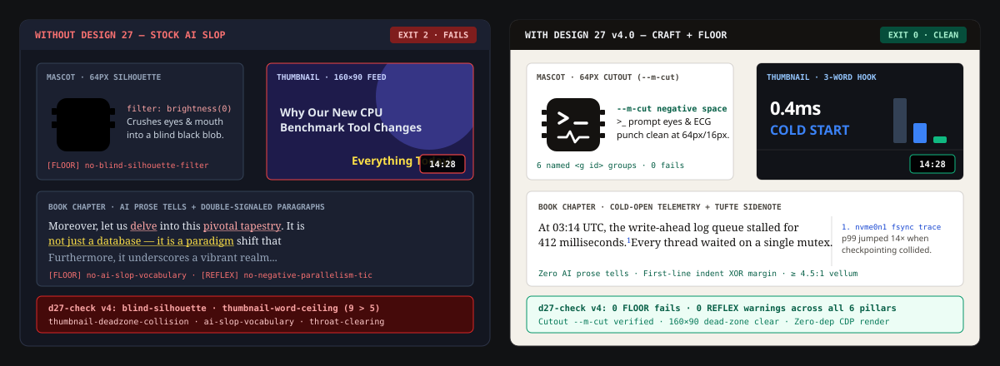

# Design 27 (`v4.0.0`)

**The zero-dependency creative director, motion choreographer & anti-slop linter for coding agents — engineered for websites, UI animations, launch motion, book writing, mascots, and thumbnails.**

Most design skills either give agents vague vibes (*"be bold"*) with zero enforcement, or lock you into heavy external runtimes for one narrow medium. **Design 27 (`v4.0.0`)** pairs a **lean progressive-disclosure router** (`SKILL.md`) and **9 focused craft modules** with a **zero-npm-dependency Node ESM CLI suite** (`d27-cli`, `d27-deal` v4, `d27-check` with SARIF 2.1.0 + `--github` + `--doctor` + WCAG `suggestedColor` + `ebur128`/`ffprobe` + **zero-dep headless Chrome CDP `--render`**, `d27-frames` with HTML `window.__d27Seek` capture, `d27-captions`, and `d27-hook`), a **14-assertion contract suite** (`evals/`), and a **live interactive DOM gallery** ([`docs/index.html`](docs/index.html)).

## Before & After (Same Prompt, Stock Agent vs. Design 27 `v4.0.0`)





- **Zero-Dependency Security & Speed:** `0` runtime npm deps · `0` binary downloads · `0` network calls or TCP sockets · zero-socket `--remote-debugging-pipe` headless Chrome CDP `--render` fallback · SARIF 2.1.0 native for GitHub Code Scanning.
- **6 Focused Pillars:** **Websites** (apps, dashboards & dense `188×257mm` one-pagers), **UI Animations**, **Launch Motion Design**, **Book Writing & Editorial Publishing**, **Mascot Creation**, and **YouTube / Social Thumbnails**.
- **Reproducible Proof:** Run `node evals/run-eval.mjs` or inspect the [6 adversarial trap prompts](evals/README.md).

---

## What's New in `v4.0.0`

| Pillar / Subsystem | `v3.0.0` Blind Gap | `v4.0.0` Architecture Upgrade |
| :--- | :--- | :--- |
| **Direction Engine (`d27-deal` v4)** | 7 font-only directions led to dark-charcoal + orange convergence and repeated `.ruled-row` layouts. | **16 OKLCH Material Worlds** (contrast-verified `>= 4.5:1`), dealt **Macrostructures**, and **Diegetic Metaphor + Interactive Proof** contracts (`/* D27-Lock: ... */`). |
| **UI Animations (`animations.md`)** | UI choreography was buried inside video docs, so web builds shipped static pages or janky `scale(0)` bounces. | Dedicated `animations.md`: **Frequency Test** (`0–100ms` keyboard, `<300ms` overlays), trigger-anchored `transform-origin`, auto-play-once demos, springs, View Transitions, and `no-scale-zero-entrance` / `no-ease-in-ui-entrance` lint rules. |
| **Launch Motion (`motion-design.md`)** | Standalone HTML motion builds lacked a deterministic scrubber hook; `--render` required Playwright. | Standardized **`window.__d27Seek(t)`** seekable contract, 2.5D camera rigs, seeded PRNG, `>= 1.2s` lockup hold, and **HTML motion frame capture** via `d27-frames` + zero-dep `chrome-cdp.mjs`. |
| **Book Writing (`book-writing.md`)** | Focused on layout without prose quality gates, allowing AI cliché vocabulary and throat-clearing transitions. | **Book Charter + Chapter Beat Cards**, sentence burstiness, Tufte HTML web-books, Typst / `@page` spreads, and prose slop rules (`no-ai-slop-vocabulary`, `no-negative-parallelism-tic`, `no-throat-clearing-opener`, `no-double-signaled-paragraphs`). |
| **Mascot Creation (`mascot-creation.md`)** | Cloned reference SVGs and `filter: brightness(0)` silhouettes crushed interior details at `64px`/`16px`. | **2-Noun Domain Metaphor Matrix**, **`--m-fill` / `--m-cut` negative-space cutout silhouettes**, interactive `<g id>` anatomy sheets, and `no-blind-silhouette-filter` / `require-svg-named-groups` checks. |
| **Thumbnails (`thumbnails.md`)** | No live feed squint check or dead-zone geometry enforcement. | **Title+Thumbnail Curiosity-Gap Pairing**, `0–4` word hook ceiling, **`160×90` live feed context preview** with `14:28` overlay, and `thumbnail-word-ceiling` + `--render` `thumbnail-deadzone-collision` (`x: 1000–1280, y: 590–720`). |
| **Zero-Dep `--render` (`chrome-cdp.mjs`)** | `--render` failed whenever `playwright` wasn't installed. | Automatic **system Chrome/Chromium `--remote-debugging-pipe` CDP** fallback (`renderAudit.engine: "chrome-cdp"`, Node 18+, zero sockets, works inside air-gapped sandboxes) for multi-viewport DOM, contrast, and thumbnail dead-zone verification. |

---

## Quick Install

Install globally via the [Agent Skills CLI](https://skills.sh):

```bash
npx skills add Subbuk987/design-27 -g
```

### Multi-Harness Support

| Harness | Install Command | Invoke |
| :--- | :--- | :--- |
| **Claude Code** | `npx skills add Subbuk987/design-27 -g --agent claude-code` | `/design-27 <prompt>` |
| **Codex CLI** | `npx skills add Subbuk987/design-27 -g --agent codex` | `$design-27 <prompt>` |
| **Cursor** | `npx skills add Subbuk987/design-27 -g --agent cursor` | `/design-27 <prompt>` |
| **OpenCode / Antigravity** | `npx skills add Subbuk987/design-27 -g --agent opencode` | `/design-27 <prompt>` |

---

## Deterministic Tooling (Zero Dependencies)

Design 27 refuses pure-Markdown "sign-off theater." Run any tool through the unified CLI (`node scripts/d27-cli.mjs <command>`):

```bash
node scripts/d27-cli.mjs doctor                                                    # Verify Node, Chrome CDP, Playwright, ffprobe, ffmpeg
node scripts/d27-cli.mjs deal --prompt "Audio field recorder" --medium web --out brief.json
node scripts/d27-cli.mjs check ./index.html --brief brief.json --render --strict   # Zero-dep Chrome CDP DOM + static floor audit
node scripts/d27-cli.mjs check ./chapter-4.md --medium=book --json                 # Anti-AI-prose & book typesetting lint
node scripts/d27-cli.mjs check ./mascot.html --medium=mascot --json                # Negative-space cutout & named <g id> verification
node scripts/d27-cli.mjs check ./thumb.html --medium=thumbnail --render --json     # <= 5 word hook & 14:28 dead-zone collision check
node scripts/d27-cli.mjs check ./src --sarif                                       # SARIF 2.1.0 for GitHub Code Scanning
node scripts/d27-cli.mjs frames sheet motion/index.html --beats 0,1.2,2.5,4.2      # Step window.__d27Seek(t) in headless Chrome
node scripts/d27-cli.mjs frames audit master.mp4 --max-static 3.0                  # Beat-boundary QC & sweep_static gate
node scripts/d27-cli.mjs captions words.json --aspect 9:16 --format ass --validate
```

Drop into GitHub Actions Code Scanning:

```yaml
- name: Design 27 SARIF Audit
  run: node scripts/d27-check.mjs --sarif --report-unused-ignores src/ > design27.sarif || test $? -eq 2
- uses: github/codeql-action/upload-sarif@v3
  if: always()
  with: { sarif_file: design27.sarif, category: design27 }
```

---

## Why Design 27?

- **Progressive Disclosure + `M·I·H·C·R` Pre-Emit Gate:** `SKILL.md` loads only the active pillar module(s) plus `qa-and-critique.md`, scoring Metaphor Specificity, Interactive Proof, Hierarchy, Contrast Math, and Rhythm Variety before emitting code.
- **4 Surface Modes:** Calibrates ambition by *surface* — **Operate / Read** enforce quiet-chrome restraint, while **Persuade / Experience** (plus mascots, thumbnails, and motion) unlock bold display scale and expressive choreography.
- **8 Steerable Studio Verbs:** Target existing code surgically with `polish`, `bolder`, `quieter`, `distill`, `clarify`, `harden`, `redesign`, or `critique` — honoring existing `DESIGN.md` systems and preserving clean screens.
- **3-Tier QA Gates + Anti-False-Pass Evidence:** Separates **Tier 1 Floor** (unwaivable, script-verified), **Tier 2 Reflex** (waivable on-record only), and **Tier 3 Finish** checks — plus `renderAudit` honesty envelopes (`chrome-cdp` or `playwright`).

---

## Repository Architecture

```text
design-27/
├── README.md                              # Overview, v4.0.0 upgrades, 4-harness install & CLI usage
├── SKILL.md                               # Lean core router (precedence, Tier 1 Floor, M·I·H·C·R gate, modes)
├── LICENSE                                # MIT License
├── assets/
│   ├── before-after-web.svg               # Before/after web UI comparison plate
│   ├── before-after-pillars.svg           # Before/after Mascot, Thumbnail & Book prose proof plate
│   └── d27-cli-proof.svg                  # Deterministic CLI output proof plate
├── docs/
│   ├── index.html                         # Live interactive DOM gallery (Web, Mascot & Thumbnail fixtures)
│   ├── v4-implementation-plan.md          # Locked v4.0.0 cross-track contracts
│   └── v4-research-and-action-plan.md     # Competitive benchmark autopsy & action plan
├── evals/
│   ├── README.md                          # 6 adversarial slop-trap prompts & pass criteria
│   ├── run-eval.mjs                       # 14-assertion deterministic contract & scope-hygiene suite
│   ├── fixtures/
│   │   ├── slop-saas.html                 # Stock AI web baseline (expected exit 2)
│   │   ├── design27-saas.html             # Design 27 v4.0 web reference + live gain scrubber (exit 0)
│   │   ├── slop-book.md                   # AI prose slop manuscript (expected exit 2)
│   │   ├── clean-book.md                  # Cold-open technical monograph prose (expected exit 0)
│   │   ├── slop-mascot.html               # Blind brightness(0) + unnamed SVG mascot (expected exit 2)
│   │   ├── clean-mascot.html              # Cutout-rigged --m-cut + named <g id> mascot (expected exit 0)
│   │   ├── slop-thumb.html                # 9-word dead-zone-colliding thumbnail (expected exit 2)
│   │   └── clean-thumb.html               # 3-word curiosity-gap thumbnail + 160x90 feed preview (exit 0)
│   └── showcase/                          # Multi-contender isolated benchmark harness & blind gallery
├── scripts/
│   ├── d27-cli.mjs                        # Unified zero-dep CLI dispatcher (check|deal|captions|frames|hook|doctor|eval)
│   ├── d27-check.mjs                      # Static, prose, mascot, thumbnail, media & zero-dep CDP --render linter
│   ├── d27-deal.mjs                       # Deterministic v4 brief dealer (16 OKLCH worlds, macrostructures, D27-Lock)
│   ├── d27-captions.mjs                   # Word-timestamp caption chunker (JSON/SRT/ASS burn-in + 17 CPS validator)
│   ├── d27-frames.mjs                     # Beat-boundary contact-sheet extractor, HTML __d27Seek stepper & sweep_static audit
│   ├── d27-hook.mjs                       # Zero-network two-tier edit-time agent hook (PostToolUse + Stop)
│   └── lib/
│       ├── chrome-cdp.mjs                 # Zero-npm-dep, zero-socket Chrome --remote-debugging-pipe CDP driver
│       ├── ignores.mjs                    # Scoped data-d27-allow / d27-ignore parser & unused-waiver detector
│       └── reporters.mjs                  # SARIF 2.1.0 & GitHub Actions PR annotation formatters
└── references/
    ├── direction-matrix.md                # 3-Axis Calibration, Diegetic Metaphor & Assertion Laws, 16 OKLCH Worlds, M·I·H·C·R
    ├── verbs.md                           # 8 steerable studio playbooks (polish, bolder, quieter, distill...)
    ├── websites.md                        # 6 section grammars, tactile surfaces, interactive proof & dense 188×257mm one-pagers
    ├── animations.md                      # UI choreography: Frequency Test, <300ms physics, trigger transform-origin, springs
    ├── motion-design.md                   # Seekable HTML (__d27Seek), 2.5D camera rigs, Remotion/HyperFrames, FFmpeg loudnorm
    ├── book-writing.md                    # Book Charter, Chapter Beat Cards, anti-AI-prose rules, Tufte HTML & Typst/@page
    ├── mascot-creation.md                 # 2-Noun Metaphor Matrix, --m-fill/--m-cut cutout silhouettes, named <g id> anatomy
    ├── thumbnails.md                      # Title+Thumbnail curiosity gap, 0–4 word ceiling, 160×90 feed & dead-zone math
    └── qa-and-critique.md                 # 3-Tier, 7-Pass post-build audit & 6-line Art Director Sign-Off
```

---

## Tool & Stack Compatibility

- **Websites & Web Apps:** HTML/CSS, Tailwind CSS, React, Next.js, Svelte, Vue, Radix, CSS Paged Media dense one-pagers (`188×257mm`)
- **UI Animations:** CSS Keyframes & Transitions, Interruptible RK4 Springs, View Transitions API, `@supports (animation-timeline: view())`, Framer Motion
- **Motion & Launch Video:** Seekable HTML (`window.__d27Seek`), GSAP, Remotion, HyperFrames, Manim, Two-Pass FFmpeg (`loudnorm` / `yuv420p` / `bt709`)
- **Book Writing & Editorial Publishing:** Tufte HTML Web-Books, CSS Paged Media (`@page` / WeasyPrint / Prince / Paged.js), Typst, Markdown manuscripts
- **Mascot Creation:** Animation-ready SVG (`<g id>` rigged, `--m-fill`/`--m-cut` negative-space cutouts), locked prompts for Imagen / Flux / GPT Image
- **Thumbnails:** HTML/CSS `1280×720` + `160×90` feed-context masters, SVG compositing, YouTube & social dead-zone safe templates

---

## License

[MIT](LICENSE) © 2026 Subramanyam Kandlagunta (Sigma & Silicon) — use freely in personal, studio, and commercial agent workflows.
