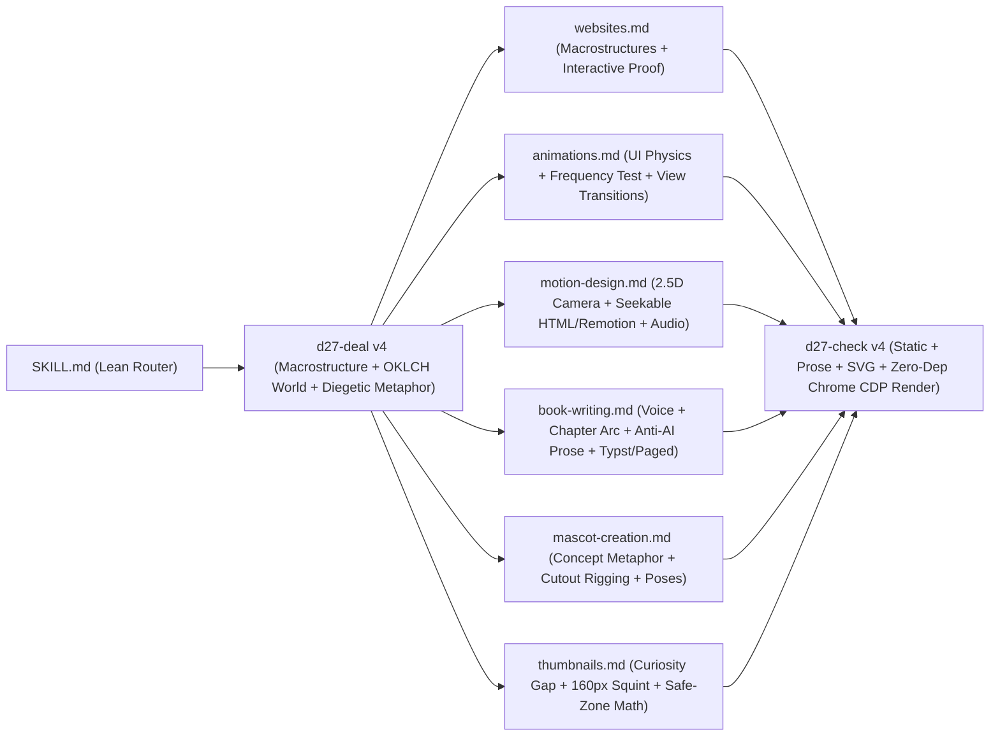

# Design 27 `v4.0` — Deep Competitive Research & Final Action Plan

> [!IMPORTANT]
> **Why `v3.0.0` passed `d27-check` (`0/0`) yet failed to stand out in blind head-to-head testing:** Design 27 currently optimizes for *compliance restraint* (not breaking contrast, overflow, or card bans), whereas top contenders win human eyes in the first 2 seconds through **Diegetic Worldbuilding** (`impeccable`), **Interactive Product Proof Toys** (`frontend-design`), **Macrostructure + Material Diversity** (`hallmark`), and **Physics/Origin-Aware Micro-Choreography** (`emilkowalski/skills`).

---

## 1. Empirical Autopsy: What Actually Happened in `evals/showcase/`

Inspecting your isolated Sonnet 5.5 outputs side-by-side in [`evals/showcase/RESULTS.md`](../evals/showcase/RESULTS.md) reveals **five concrete failure modes** inside Design 27's current prompts and scripts:

| Blind Failure Mode | Evidence in Design 27's Own Outputs | What Beat It in the Same Run |
| :--- | :--- | :--- |
| **1. "Polite Charcoal + Safety-Orange" Convergence** | Across *two unrelated prompts* — [`evals/showcase/web/design-27/index.html`](../evals/showcase/web/design-27/index.html) (*Kova Field* recorder) and [`evals/showcase/illustration/design-27/index.html`](../evals/showcase/illustration/design-27/index.html) (*Pulsebit* CLI mascot) — Design 27 emitted **`Geist` + `JetBrains Mono` + `#090B10`/`#0F0E12` dark ground + exact `#FF5B1F` orange** both times. On `web`, its palette was nearly indistinguishable from no-skill baseline [`evals/showcase/web/none/index.html`](../evals/showcase/web/none/index.html) (`#12130f` + `#ff6a2b`). | **Impeccable** ([`evals/showcase/web/impeccable/index.html`](../evals/showcase/web/impeccable/index.html)) invented a **Diegetic Metaphor**: a `#c9cbc0` 16mm Academy film countdown leader with live `8→2` cue-red pop, 35mm sprocket-hole spec frames, and an on-set Sound Report table. **Hallmark** ([`evals/showcase/web/hallmark/index.html`](../evals/showcase/web/hallmark/index.html)) dealt `oklch(74% 0.008 80)` cast concrete + `feTurbulence` grain + `Oswald` brutalist bars. |
| **2. Static Pages (`0` Interactive Proof)** | [`evals/showcase/web/design-27/index.html`](../evals/showcase/web/design-27/index.html) drew two static SVG waveforms and `0` lines of JS. Because UI animation lives inside video-focused [`references/motion-design.md`](../references/motion-design.md), web builds skip it completely. | **Frontend-Design** ([`evals/showcase/web/frontend-design/index.html`](../evals/showcase/web/frontend-design/index.html)) built a **live draggable `1.0x–8.0x` input-gain oscilloscope** that auto-sweeps once on load so the user *feels* phone clipping vs. 32-bit float recovery. |
| **3. Reference-Example Cloning ("Fox-Ear CPU Bug")** | Because [`references/mascot-and-illustration.md`](../references/mascot-and-illustration.md) contains one literal SVG example (a `#D9410B` fox with `#FFF7EE` belly, `rotate(-4)` tilt, and a *notched right triangular ear*), the agent grafted **pointed fox ears with a notched right ear + cream belly + rosy cheeks** onto a *CPU microchip* ([`evals/showcase/illustration/design-27/index.html`](../evals/showcase/illustration/design-27/index.html)). | **Impeccable** ([`evals/showcase/illustration/impeccable/index.html`](../evals/showcase/illustration/impeccable/index.html)) gave the microchip **terminal prompt `>_` eyes** (`>` chevron + `_` cursor), a sweeping ECG mouth glint, and **interactive `#group` hover isolation** that dims non-hovered SVG groups to `14%`. |
| **4. Broken `brightness(0)` Silhouette Test** | Following [`references/mascot-and-illustration.md`](../references/mascot-and-illustration.md) literally (*"fill outer form in solid `#000`"*), Design 27 wrote `.sil { filter: brightness(0); }`, crushing internal eyes and pulse line into a featureless blob at `16px`. Meanwhile `no-freehand-svg-clipart` (`>12` primitives) false-flagged **every single mascot** in [`evals/showcase/RESULTS.md`](../evals/showcase/RESULTS.md). | **Impeccable**, **Hallmark**, **HyperFrames**, and **Frontend-Design** all used **CSS custom-property token inversion or `<mask>` Boolean cutouts** so eyes and heartbeat mouth punch cleanly through the `64px / 32px / 16px` silhouette as negative space. |
| **5. Repetitive `.ruled-row` Middle & Eyebrow Tic** | [`references/websites.md`](../references/websites.md) teaches one primary anti-card recipe (`01 / 02 / 03` `.ruled-row` + plain `<table>`) and puts tracked uppercase `.meta` eyebrows above every section (`5×` in *Kova Field*). In `hallmark`'s `sloplint`, eyebrow-above-every-heading is itself an AI tell. | **Hallmark** deals from **21 whole-page macrostructures** (*Workbench, Field Specimen, Broadsheet, Manifesto, Ledger...*) so two consecutive pages never share the same skeleton. |

---

## 2. Ecosystem Benchmark: Who Leads Each Pillar Today & How Design 27 Beats Them All

We researched the leading open-source skills across GitHub and `skills.sh`: **`pbakaus/impeccable`**, **`nutlope/hallmark`**, **`emilkowalski/skills`**, **`ibelick/ui-skills`**, **`ui-ux-pro-max`**, **`heygen-com/hyperframes`**, **`remotion-dev/skills`**, **`AdrianMastronardi/bookwright`**, **`blader/humanizer`**, **`hassancs91/claude-youtube-editor`**, and **`Svg Mascot Animator`**.

| Target Pillar | Current Specialist Leader(s) | Their Secret Weapon | How Design 27 `v4.0` Surpasses Them |
| :--- | :--- | :--- | :--- |
| **1. Websites** *(+ Apps & Dense Reference)* | `pbakaus/impeccable` · `nutlope/hallmark` | Diegetic world metaphor (`impeccable`); 21 page macrostructures + OKLCH tactile themes + `sloplint` (`hallmark`). | Combine **16+ Macrostructures + OKLCH Material Worlds** in `d27-deal` WITH **Mandatory Diegetic Artifact + 1 Interactive Proof Widget** on *Persuade/Experience* pages. |
| **2. Animations** *(UI & Interactive Web)* | `emilkowalski/skills` · `ibelick/ui-skills` | Frequency Test (don't animate `100×/day` or keyboard actions), `<300ms` UI cap, zero `ease-in` entrances, `scale(0.95→1)` from trigger `transform-origin`. | Split UI choreography out of video into a dedicated **`references/animations.md`** loaded alongside `websites.md` & `mascot-creation.md`, adding **Interruptible Springs, View Transitions, Scroll-Timeline progressive enhancement, and Interactive Micro-Demos**. |
| **3. Motion Design** *(Launch Films & Code Video)* | `heygen-com/hyperframes` · `remotion-dev/skills` | Seekable `window.__timelines` / `useCurrentFrame()`, 2.5D camera dolly/whip-pan rigs, kinetic word-level captions, headless frame verification. | Upgrade `motion-design.md` with **Camera Rig & Depth-Plane Recipes**, **Interactive Scrubber Player Contract** (for standalone HTML motion pieces), and **HTML Timeline Frame-Stepping** inside `d27-frames.mjs` via headless Chrome. |
| **4. Book Writing** *(Manuscript + Editorial Publishing)* | `AdrianMastronardi/bookwright` · `blader/humanizer` | `manifesto` + `voice` + `outline` gates before drafting, 3-pass developmental/line/copy edit (`bookwright`); Wikipedia *Signs of AI Writing* purge (`humanizer`). | Transform `books-and-editorial.md` into **`references/book-writing.md`** unifying **Nonfiction/Technical Narrative Architecture + Anti-AI-Prose Linter (`d27-check`) + Typst / Paged.js / Interactive Web-Book Typesetting**. |
| **5. Mascot Creation** | `impeccable` · `Svg Mascot Animator` | Domain-metaphor anatomy (`>_` prompt eyes), CSS-var negative-space silhouette cutouts, interactive SVG group inspection, spring micro-idle rigging. | Rewrite into **`references/mascot-creation.md`**: kill the cloned fox template, enforce the **Object-Metaphor Matrix**, **Negative-Space Cutout Silhouette Pattern**, **Multi-State Pose/Expression Switcher**, and **Mascot-Aware SVG Linting**. |
| **6. Thumbnails** | `claude-youtube-editor` · creator CTR systems | Title+Thumbnail **Curiosity-Gap Pairing** (never repeat title), 3-element budget, gaze-vector math, `160×90px` feed preview. | Upgrade **`references/thumbnails.md`** + `d27-check` with **Title-vs-Thumbnail Complementarity**, **Live YouTube/Social Feed Context Previewer** (renders the `1280×720` card alongside a `160×90` dark/light mobile feed row with the `14:28` timestamp pill overlaid!), and dead-zone collision checks. |

---

## 3. Prioritized Final Action Items

### Phase 0 — Scope Surgery: Remove Poster & Slides Support Cleanly
Delete every poster and slide/presentation artifact so 100% of context budget and test coverage focuses on your 6 core domains:
1. **Delete files:**
   - [`references/posters.md`](../references/posters.md)
   - [`references/presentations.md`](../references/presentations.md)
   - [`assets/before-after-deck.svg`](../assets/before-after-deck.svg) (replace in `README.md` with Motion / Mascot+Thumbnail / Book comparison proof).
2. **Scrub & re-route references across:**
   - [`SKILL.md`](../SKILL.md) (update YAML `description`, Surface Modes, and Progressive Disclosure Router table).
   - [`scripts/d27-deal.mjs`](../scripts/d27-deal.mjs) (rename `brutalist-poster` → `swiss-brutalist` / `industrial-monolith` so no poster terminology leaks).
   - [`references/qa-and-critique.md`](../references/qa-and-critique.md), [`references/direction-matrix.md`](../references/direction-matrix.md), [`references/verbs.md`](../references/verbs.md), [`references/books-and-editorial.md`](../references/books-and-editorial.md), [`README.md`](../README.md), [`evals/README.md`](../evals/README.md) (replace Prompt 02 pitch deck with a **Book Chapter + Anti-Slop Prose & Typesetting** trap prompt), and [`evals/showcase/PROMPTS.md`](../evals/showcase/PROMPTS.md) (replace `poster` category with `thumbnail` or `book`).
   - *Salvage universal gold before deleting:* Move the **Assertion Headline Law** (*"write headlines as falsifiable claims, not topic labels"*) from `presentations.md` and **Extreme Display Scale (`5:1–10:1` at `0.86–0.94` leading)** from `posters.md` into `direction-matrix.md`.

---

### Phase 1 — Core Engine: Fix "Polite Convergence" in `SKILL.md`, `direction-matrix.md` & `d27-deal.mjs`

> [!WARNING]
> As long as `d27-deal.mjs` only deals 7 font-only directions without **Macrostructures**, **OKLCH Palettes**, or a **Diegetic Metaphor / Interactive Signature**, agents will keep emitting dark `#090B10` + `Geist` + `#FF5B1F` orange with `.ruled-row` lists.

1. **Upgrade [`scripts/d27-deal.mjs`](../scripts/d27-deal.mjs) (`schemaVersion: 4`):**
   - Expand from 7 generic directions to **16+ curated OKLCH Material Worlds** (including physical mid-tones like *35mm Film Leader*, *Cast Formwork Concrete*, *Milled Anodized Aluminum*, *Archival Monograph Vellum*, *Phosphor Oscilloscope*, *Risograph Soy Newsprint*, *Deep Botanical Ink*, *Swiss Railway Enamel*, *Warm Clay Studio*, etc.) — with **pre-verified WCAG/APCA OKLCH + hex token ramps** (`--surface-canvas`, `--surface-elevated`, `--ink-primary`, `--ink-secondary`, `--accent-focal`, `--accent-ink`) so agents stop picking `#090b10` + `#ff5b1f`.
   - Deal a **Named Page/Artifact Macrostructure** (`--medium web|animation|motion|book|mascot|thumbnail`), e.g. for `web`: *Interactive Instrument / Oscilloscope*, *Diegetic Artifact Frame*, *Editorial Broadsheet*, *Split Monograph*, *Technical Spec Sheet*, *Manifesto Ledger*, *Product Workbench* — explicitly banning repeating `.ruled-row` `01/02/03` on non-index shapes.
   - Add `signatureContract`: requires **1 Diegetic Physical Metaphor** (derived from the subject's real physical craft — film leader for cinema, milled metal + decibel scale for audio, terminal prompt glyphs for CLI) + **1 Functional Interactive Proof** on web/mascot/motion showcase builds.
2. **Add Pre-Emit Self-Critique Gate (`M·I·H·C·R` Score) to [`SKILL.md`](../SKILL.md):**
   - Before writing code (and recorded in a top CSS comment lock), require scoring 1–5 on **Metaphor Specificity, Interactive Proof, Hierarchy, Contrast Math, and Rhythm Variety** — if Metaphor or Interactive Proof `< 4` on a *Persuade/Experience* build, mutate the concept before emitting HTML.

---

### Phase 2 — Domain-by-Domain Craft Upgrades (Making Every Pillar #1)

#### Pillar 1: Websites (`references/websites.md`)
1. **Replace Single `.ruled-row` Default with 6 Distinct Section Grammars:** Spec Matrix, Interactive Proof Stage (slider/toggle/live calculator proving the core claim), Perforated/Framed Artifact Strip, Sticky Narrative Walkthrough, Asymmetric Editorial Plate, and Tactile Form/Checkout Block.
2. **Kill the "Eyebrow Above Every Heading" AI Tic:** Cap tracked-uppercase eyebrows to **at most 1–2 structural landmarks per page** (e.g., masthead/hero metadata), never mechanically stamped above every `<h2>` (`d27-check` new `REFLEX` rule: `no-eyebrow-spam`).
3. **Tactile Surface Recipes (Zero External Assets):** Ship compact copy-ready CSS patterns for subtle `feTurbulence` paper/metal grain (`<= 0.05` opacity), brushed/anodized SVG micro-patterns, physical keycap/button press depth (`box-shadow` + `:active { translate: 0 2px }`), and concentric radii.
4. **Honest Interactive Controls:** When a brief includes a CTA, comparison, or technical claim, include **one genuine zero-dependency interactive element** (gain/comparison scrubber, unit/billing toggle, live spec filter, or accessible validated preorder/waitlist form with `aria-live` feedback).

#### Pillar 2: UI Animations (`references/animations.md` — **NEW Dedicated Module**)
Separate UI & interactive web animation cleanly from video production so web/app/mascot tasks always load crisp design-engineering choreography (incorporating `emilkowalski/skills` + `ibelick` + Linear/Apple craft):
1. **The Frequency & Intent Gate:**
   - `100×/day` actions & keyboard shortcuts (`Cmd+K`, arrow nav, form typing): **`0ms`–`100ms`** (instant; never animate keyboard-driven focus/selection).
   - Hover/press/toggle micro-feedback: **`120ms–200ms`** (`--ease-out-quart`, tactile `:active` scale `0.97` or `2px` press).
   - Popovers, dropdowns, modals, drawers: **`180ms–280ms`** (`< 300ms` hard ceiling), **`scale(0.95 → 1)` + `opacity`** (ban `scale(0)`!), anchored to trigger **`transform-origin`** (`top left`, `bottom center`, etc.), exits `25%` faster than entrances, **never `ease-in` on entrances**.
2. **Signature Load Moment ("Auto-Play Once, Then Hand Off"):**
   - Teach the exact pattern that made `frontend-design` and `impeccable` shine: **one `1.2s–2.4s` domain-specific demonstration on initial load** (e.g., waveform sweeping up into clip range once, terminal benchmark counting up once, ECG line tracing once via `pathLength="1"`), immediately cancellable on `pointerdown`/`keydown` and skipped cleanly under `prefers-reduced-motion: reduce`.
3. **Modern Web Choreography Primitives:**
   - Interruptible CSS transitions vs. JS spring solver (`~25`-line zero-dep critically-damped RK4/analytical spring helper for draggable/interactive demos), `document.startViewTransition()` state morphs, FLIP layout transitions, and `@supports (animation-timeline: view())` progressive scroll-linked reveals that never leave elements stuck at `opacity: 0`.

#### Pillar 3: Motion Design (`references/motion-design.md`)
Make Design 27 beat both `hyperframes` and `remotion-dev/skills` on launch videos AND standalone HTML motion pieces:
1. **Standalone HTML Motion Player Contract (for `index.html` launch spots):**
   - Standardize a zero-dependency **deterministic `seek(t)` architecture**: every element's transform/opacity/SVG state is a pure function `renderAt(frame)` (`0..totalFrames`), wired to a crisp minimal studio scrub bar (`Play/Pause`, `0.00s / 5.00s` `tabular-nums`, draggable `<input type="range">` scrubber, `Space` / `←` / `→` frame-stepping, and `window.__d27Seek(t)` hook so headless Chrome can capture exact frames!).
2. **2.5D Camera Rig & Multi-Plane Depth Recipes:**
   - Add concrete math for **Camera Wrapper `
`** (`perspective: 1200px`, Z-dolly push `scale(1 → 1.38)`, subtle `rotateX/Y` parallax across Foreground / Subject / Background planes, directional mask wipes, and matched-velocity whip cuts) — ending flat "slideshows in a video div".
3. **Procedural Audio/Data Motifs & Final Lockup Hold:**
   - Seeded deterministic PRNG (`mulberry32(seed)`) for organic waveforms/particles (zero `Math.random()`), word-by-word masked kinetic typography with optical reading holds, and mandatory **final 20–25% (`>= 1.2s`) lockup hold** with zero late layout shifts.

#### Pillar 4: Book Writing & Editorial Publishing (`references/book-writing.md` — **Expanded from `books-and-editorial.md`**)
Turn Design 27 into the undisputed #1 skill for **writing AND typesetting** non-fiction books, technical manuals, essays, monographs, and web-books:
1. **Stage 1–2 Manuscript Architecture (Inspired by `bookwright`):**
   - Never draft chapters cold. Lock a **Book Charter** (`Thesis`, `Reader Transformation`, `Voice Register` — e.g., *Clinical Systems Engineer*, *Narrative Investigative*, *Opinionated Practitioner*, *Tufte Monograph*) + **Chapter Beat Card** (`Concrete Opening Scene/Problem` → `Conventional Wisdom Failure` → `Core Mechanism + Diagram/Code` → `Sharp Implication`, zero summary fluff).
2. **Hard Anti-AI-Prose Rules (Enforced Both in Writing & `d27-check`):**
   - **Banned AI Vocabulary:** *delve, tapestry, testament, landscape, pivotal, underscore, realm, beacon, vibrant, intricate, multifaceted, overarching, foster, garner, showcase (as verb)*.
   - **Banned Structural Tells:** Negative parallelisms (*"It's not just X — it's Y"*, *"Not X. Y."*), throat-clearing transitions (*"Moreover," "Furthermore," "In conclusion," "It is worth noting"*), compulsive rule-of-three adjective chains, rhetorical self-answering questions, and em-dash abuse (`<= 2` em-dashes per paragraph).
   - **Sentence Burstiness Law:** Mix crisp `5–9` word declarative punches with `22–35` word analytical clauses; open every chapter with a **concrete artifact, failure story, date/place, or measurement** — never an abstract dictionary definition.
3. **3-Format Book Output Mastery:**
   - **Web-Book / Digital Monograph (`HTML`):** Tufte sidenotes (`<aside class="sidenote">`), sticky chapter progress + TOC rail, `tabular-nums` figures, dark/paper reading toggle, and `@media print` CSS Paged Media baked in.
   - **Print / PDF Master (`Typst` & `CSS @page`):** Keep Tschichold `2:3:4:6` spread geometry, vertical chapter sinkage, `widows/orphans: 3`, and zero double-signaled paragraphs (`text-indent` XOR `margin-bottom`).

#### Pillar 5: Mascot Creation (`references/mascot-creation.md` — **Rewritten from `mascot-and-illustration.md`**)
Eliminate reference-cloning and make every SVG mascot unmistakably clever, legible at `16px`, and interactive:
1. **Replace the Cloned Fox SVG with the "Concept-to-Anatomy Metaphor Matrix":**
   - Teach agents to fuse **2 concrete domain nouns** into character anatomy (e.g., *CPU + Benchmark* → IC pins as sprinting legs + `>_` prompt eyes + ECG mouth; *Database + Vault* → hexagonal platter shell + keyway visor; *Audio + Field* → windscreen fur crest + VU-meter pupils) — **banning generic cat/fox ears on non-animal technical tools** unless requested.
2. **Mandatory CSS-Variable Negative-Space Silhouette Architecture:**
   - Ban `.sil { filter: brightness(0); }`! Provide the exact **`--m-fill` / `--m-cutout` CSS custom-property + `<use href="#mascot">` (or `<mask>`) pattern** so eyes, mouth, and signature interior glyph automatically invert to background color (`--sil-bg`) at `64px`, `32px`, and `16px`.
3. **Interactive Model-Sheet Showcase Pattern:**
   - When showcasing a mascot in HTML, include: **(a)** named `<g id="...">` anatomy chips that highlight/isolate each group on hover/focus, **(b)** 1 restrained character-true micro-motion (`blink`, `pathLength` pulse trace, or subtle `transform-box: fill-box` idle breath — gated by `prefers-reduced-motion`), and **(c)** multi-scale cutout ladder (`400px` → `64px` → `32px` → `16px` on light & dark).

#### Pillar 6: Thumbnails (`references/thumbnails.md`)
1. **Title + Thumbnail Curiosity-Gap Pair:** Require emitting the **paired Video/Article Title alongside the Thumbnail** so the two form a complementary loop (Thumbnail = *visceral visual anomaly / `0–3` word tension*; Title = *specific context*). Hard fail if thumbnail text repeats `>= 50%` of title words.
2. **Feed-Context Proof Wrapper (HTML Thumbnail Builds):**
   - When generating an HTML thumbnail, render the exact `1280×720` exportable `#thumbnail-canvas` **AND** a live **`160×90px` YouTube Dark/Light Feed Preview Card** below/beside it complete with the real **`14:28` bottom-right timestamp overlay (`x: 1000–1280, y: 590–720`)** and video title — making squint legibility and dead-zone clearance visually undeniable in 1 glance!
3. **High-Contrast Vector/SVG + Composited Plate Craft:** Rim-light separation, `>= 7:1` hook contrast, gaze-line arrows/framing, and `250–400%` UI/metric macro zoom rules.

---

### Phase 3 — Deterministic CLI & Linter Upgrades (`scripts/d27-check.mjs` & `d27-frames.mjs`)

> [!TIP]
> Fixing these linter blind spots turns Design 27's craft rules from "markdown wishes" into **automated, zero-dependency gates** that work on any machine with Chrome or Node.

1. **Zero-Dependency Headless Chrome Fallback for `--render` (`d27-check.mjs`):**
   - Today `--render` fails whenever `playwright` npm package isn't installed ([`evals/showcase/RESULTS.md`](../evals/showcase/RESULTS.md)). Add an automatic fallback probing system Chrome/Chromium (`/Applications/Google Chrome.app/...`, `chromium`, `google-chrome`) with `--headless=new` + native Node 22 `WebSocket` CDP so `--render` runs **100% zero-npm-dependency** multi-viewport overflow, contrast, fold, and screenshot checks!
2. **Fix `no-freehand-svg-clipart` False Positives & Add Mascot/Thumbnail/Book Rules:**
   - Exempt SVGs with structured named `<g id="...">` hierarchy (`>= 4` named groups + `viewBox`) from `no-freehand-svg-clipart`, and instead check **Mascot Rules**: warn on `filter: brightness(0)` silhouettes without cutout variables/masks (`no-blind-silhouette-filter`), and verify named `<g id>` groups.
   - Add **Book Writing Prose Rules** (for `.md`, `.typ`, and book `.html` targets): flag AI vocabulary (`delve`, `tapestry`, `testament`, `pivotal`, `underscore`, etc.), negative parallelisms (`not just X, it's Y`), double-signaled paragraphs (`text-indent` + `margin-bottom` together), and eyebrow spam (`> 3` identical `.eyebrow`/`.meta` tags before `h2`s).
   - Add **Thumbnail Rules** (when `--medium=thumbnail` or `.yt-thumb` / `1280x720` stage detected): enforce `<= 4` words inside headline hook and check bounding-box clearance against `x: 1000–1280, y: 590–720` in render mode.
3. **HTML Motion Scrub & Contact-Sheet Support in `d27-frames.mjs`:**
   - Allow `node scripts/d27-frames.mjs sheet motion/index.html --beats 0,1.2,2.5,4.2` to step `window.__d27Seek(t)` / `window.__timelines` in headless Chrome and stitch a beat-boundary PNG contact sheet — even before encoding an `.mp4`!
4. **Expand `evals/` & `evals/showcase/`:**
   - Update `evals/run-eval.mjs` to test all 6 pillars (Web, UI Animation, Motion, Book Writing, Mascot, Thumbnail) + verify `0` leftover references to posters/slides.
   - Update `evals/showcase/` categories from `web, illustration, poster, motion` → your new pillar lineup (`web, mascot, thumbnail, motion, book`).
