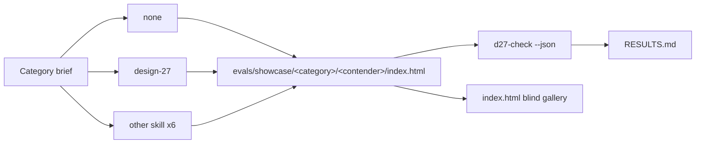

# Showcase Benchmark — Prompts & Isolation Rules

- **Contender model:** Claude Sonnet 5.5 (`claude-sonnet-5-5`), effort `high`, set explicitly on every subagent (`model: "sonnet"`, `effort: "high"`). Verified from each transcript's `message.model`.
- **Orchestrator:** Claude Opus 5.5 in Claude Code CLI (spawns subagents, builds the gallery, runs `d27-check`; never edits contender output).
- **Updated for Design 27 `v4.0.0`:** Removed `poster`; added `thumbnail` and `book` categories to match the 6 core pillars (`web`, `illustration` / mascot, `thumbnail`, `motion`, `book`).
- **Categories:** `web`, `illustration`, `thumbnail`, `motion`, `book`
- **Contenders:** `none`, `design-27`, `hyperframes`, `impeccable`, `hallmark`, `unslop`, `remotion-skills`, `frontend-design`

## Run protocol

1. Run one category batch at a time.
2. Create one empty workspace per contender **outside the repo** (`<scratch>/iso/<category>/<contender>/`). The `design-27` workspace gets a clean `git archive HEAD` copy of this repo. The others get nothing.
3. Spawn one fresh subagent per contender in parallel. Each subagent gets the isolation rules below plus the verbatim category brief, and writes only `ISO/index.html`.
4. Browser isolation: no Playwright MCP, no chrome-devtools MCP, no HTTP servers. Visual checks use headless Chrome with a private `--user-data-dir` inside the workspace and `file://` URLs.
5. Hook isolation: the global `impeccable` design hook skips files outside the project, so it does not run for any contender. The `impeccable` contender may still run its own detector as part of its native workflow.
6. The orchestrator copies each `ISO/index.html` unchanged to `evals/showcase/<category>/<contender>/index.html`.
7. Cost: `node evals/showcase/usage.mjs` sums tokens and USD from each subagent transcript (nested helper agents included). Wall time is first-to-last transcript timestamp.
8. After all batches, run `node scripts/d27-check.mjs <file> --json` on every output and record results in `RESULTS.md`.

### Skill mapping (installed names)

| Contender | Skill invoked |
|---|---|
| `none` | no skill |
| `design-27` | local `./SKILL.md` (this repo) |
| `hyperframes` | `hyperframes:hyperframes` |
| `impeccable` | `impeccable` |
| `hallmark` | `hallmark` |
| `unslop` | not installed on this machine at run time → `NOT_INSTALLED`, no file |
| `remotion-skills` | `remotion:remotion-best-practices` (Remotion plugin router) |
| `frontend-design` | `frontend-design:frontend-design` |

## Mandatory isolation & token rules (sent to every subagent)

- Output MUST be a single self-contained HTML file written to `evals/showcase/<category>/<contender>/index.html` (zero `npm install`, zero external local assets; inline SVG/CSS/JS and optional Google Fonts CDN only).
- **STRICT ISOLATION:**
  - If `<contender>` is `none`: Do NOT load any skill and do NOT read `./SKILL.md`, `./references/`, `./scripts/`, or any file in `evals/showcase/`.
  - If `<contender>` is `design-27`: Read `./SKILL.md` and execute Design 27's full 4-stage workflow to its fullest (run `node scripts/d27-deal.mjs` into `/tmp/d27-<category>-brief.json`, load the routed `references/*.md` module + `references/qa-and-critique.md`, build the file, run `node scripts/d27-check.mjs evals/showcase/<category>/design-27/index.html --brief /tmp/d27-<category>-brief.json --json`, fix every error until exit 0). Do NOT read other contenders' folders.
  - If `<contender>` is any other skill (`hyperframes`, `impeccable`, `hallmark`, `unslop`, `remotion-skills`, `frontend-design`): Load ONLY that installed skill and follow its full native workflow (including its own scripts/checks if installed). Do NOT read `./SKILL.md`, `./references/`, `./scripts/`, or any other folder in `evals/showcase/`. If a skill is not installed, stop immediately and report `NOT_INSTALLED` without writing a file.
- Reply to the parent with at most 3 lines: output path, line count, and verification status.
- Run 2 change: subagents write to `ISO/index.html` and must not read anything in the repo or in sibling workspaces. The orchestrator copies the file to the path above. The browser rule from step 4 is added to every prompt.
- Added for fairness: global "default skills" from the operator's `~/.claude/CLAUDE.md` (e.g. `ui-ux-pro-max`, `ponytail`) are suspended for every subagent, so each contender uses only its own skill. Subagents run non-interactively: no questions to the operator; make reasonable choices and finish.

## The 5 verbatim category briefs

1. **`web`** (`<= 250` lines):
> Build a single-file responsive landing page (`index.html`) for "Kova Field", a pocket-sized offline hardware audio recorder for documentary filmmakers ($349, 32-bit float, 18-hour battery, milled aluminum body). Include a hero section, 3 real hardware specs, a concise comparison strip against phone recording, and one primary preorder CTA. Do not invent fake customer testimonials or press logos.

2. **`illustration`** (`<= 200` lines):
> Build a single-file HTML showcase (`index.html`) displaying one original, clean vector mascot SVG (`viewBox="0 0 400 400"`) for "Pulsebit", a fast terminal-based CPU benchmark CLI. Show the mascot at full size alongside a 64×64px monochrome negative-space cutout silhouette preview so legibility at small scale is obvious. Keep all vector paths clean and organized in named `<g id="...">` groups.

3. **`thumbnail`** (`<= 200` lines):
> Build a single-file HTML showcase (`index.html`) featuring a `1280×720` (`16:9`) YouTube thumbnail for a systems-engineering video: *"I Replaced Our Rust Profiler With a 4KB Binary"*. Use a curiosity-gap visual pairing (0–4 words on the thumbnail that never repeat the title), keep the bottom-right `14:28` timestamp dead zone (`x: 1000–1280, y: 590–720`) completely clear of text, and render a live `160×90` dark feed preview card with the timestamp pill underneath.

4. **`motion`** (`<= 250` lines):
> Build a single-file 5.0-second (`300 frames @ 60fps`) deterministic launch motion piece (`index.html`) in a `16:9` (`1280×720`) viewport for "Kova Field — Record Anything, Anywhere." Include a clean play/pause + timeline scrub bar (`0.0s` to `5.0s`), crisp typography, a kinetic audio-waveform motif, and a clear final lockup hold for the last 1.2 seconds. Use deterministic time-driven animation (`window.__d27Seek(t)`, no `Math.random()` or unbounded loops).

5. **`book`** (`<= 250` lines):
> Write and typeset Chapter 4 (*"Why Write-Ahead Logs Stall at Midnight"*) of a technical systems monograph as a single-file HTML web-book (`index.html`) with Tufte sidenotes, a sticky reading-progress & chapter rail, `tabular-nums` latency metrics, and `@media print` `@page` rules. Open directly on a concrete `03:14 UTC` NVMe `fsync` outage with zero AI prose clichés, zero throat-clearing transitions, and zero double-signaled paragraphs.
