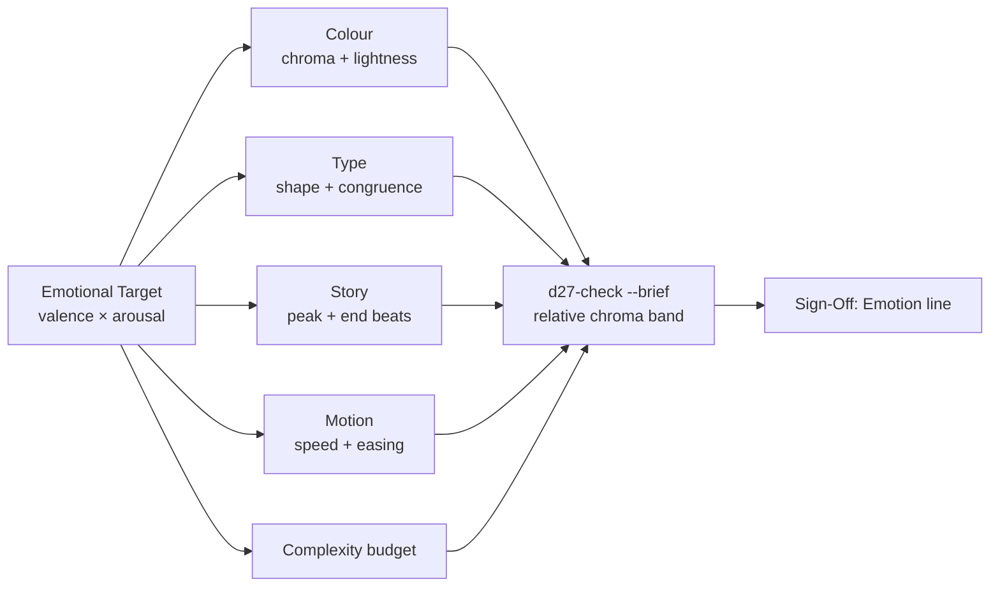

# Emotion Science — Emotional Target, Levers & Do-Not-Claim List

Load this module for every medium at Stage 1 (it is in every `brief.json` `requiredRefs`). It holds the Emotional Target bands, the lever summary, the do-not-claim list and the QA questions. The graded studies behind each lever live in [`emotion-evidence.md`](emotion-evidence.md): open it only when you must justify or tune a choice.

**Evidence grades (cite the grade when you justify a choice):**

| Grade | Meaning | How to use it |
| :--- | :--- | :--- |
| **A** | Meta-analysis, large cross-cultural sample, or effect replicated by independent labs. | Use it as a rule. You may name it in copy or rationale. |
| **B** | Solid peer-reviewed studies with a consistent direction, but limited replication or small samples. | Use it as a default. Do not overstate it. |
| **C** | Mixed, contested, or failed replication. | Use it as craft intuition only. **Never claim it as science.** |

> Scope note: these effects are averages from lab populations. Brand systems (`DESIGN.md`) and user research on the real audience always win (Rule Precedence #1).

---

## 0. The Emotional Target (Stage 1 Lock)

Lock one **Emotional Target** before you code. Lock it with the Surface Mode. Deal it with `node scripts/d27-deal.mjs ... --emotion <target>`. If you omit `--emotion`, the dealer uses the surface default: `read → calm`, `operate → focused`, `persuade → inviting`, `experience → energetic`.

Emotion has two main axes: **valence** (pleasant ↔ unpleasant) and **arousal** (calm ↔ activated). Every lever below moves one or both axes.

| Target | Valence / Arousal | Accent relative chroma | Motion ms (non-overlay) | Shape | Complexity | Typical use |
| :--- | :--- | :--- | :--- | :--- | :--- | :--- |
| `calm` | + / low | `0 – 0.55` | `300 – 600` | Curved, soft radii | Low | Books, docs, health |
| `focused` | 0 / low-mid | `0 – 0.80` | `120 – 240` | Neutral | Low | Dashboards, tools |
| `trust` | + / low-mid | `0.30 – 0.75` | `200 – 320` | Neutral | Low | Finance, legal, security |
| `inviting` | + / mid | `0.45 – 0.90` | `200 – 400` | Curved | Mid | Landing pages, product stories |
| `playful` | + / high | `0.75 – 1` | `180 – 340`, `3–8%` overshoot | Curved | Mid-high | Kids, games, events |
| `awe` | + / mid-high | `0.50 – 1` | `500 – 1200` | Mixed | Mid (focal plate) | Launch films, science, art |
| `energetic` | + / high | `0.80 – 1` | `150 – 300` | Mixed | Mid-high (focal plate) | Launches, sport |
| `urgent` | − / high | `0.85 – 1` | `100 – 200` | Angular, `0px` | Low | Alerts, incidents |

**Relative chroma** = OKLCH `C` ÷ the largest `C` sRGB allows at that `L` and `H`. Raw `C` is unfair across hues (max sRGB cyan ≈ `0.15`, blue ≈ `0.31`). These bands are a **calibrated heuristic, not a measured effect** (Grade C as numbers; the direction is Grade B). The dealer tunes the dealt accent into the band, keeping hue and lightness, and only when accent text stays at `Lc >= 60`. Motion ranges apply to section, page and scroll transitions; the `< 300ms` overlay ceiling in `animations.md` always wins.

**Lever summary** (evidence and sources in `emotion-evidence.md`):
- **Colour:** set arousal with chroma and lightness, then pick hue for domain meaning (a liked object from the subject's world).
- **Type:** curved/humanist for `calm`/`inviting`/`playful`, angular/condensed for `urgent`; body text maximally fluent; spend disfluency on one focal moment only.
- **Story:** predictable structure, surprising content; open on a scene (role, place, stake, real detail); design one **peak** and one **end**.
- **Art:** pass Sensory, Emotion and Meaning checks; give the visitor one self-relevant moment; keep texture detail mid-range.
- **Design:** first viewport = one gist, low clutter, category-typical structure; novelty goes into the world and artifact.
- **Motion:** speed and easing carry the emotion (table above); one choreographed peak, then a settling hold.

`d27-check --brief` measures the peak relative chroma of the `--accent-*` tokens against the band (`brief-emotion-chroma-mismatch`, REFLEX, `±0.05` slack).

**Plan the Peak and the End (evidence S3).** Emotion = what the audience should feel when the SMP lands. Peak = the moment the SMP lands. End = the moment the Line lands. Write both into the `D27-Lock`:

```css
/* D27-Lock: Idea: "The 6:40 leaves on time" | Persuade | Railway Enamel | Split Monograph | Platform enamel sign | Live timetable scrubber | Emotion: trust · peak=scrubber reveal · end=signed timetable CTA | M:5 I:5 H:4 C:5 R:4 */
```



---

## 7. Do-Not-Claim List (Grade C)

Remove these claims from copy, comments, and rationale:

| Claim | Status | Say instead |
| :--- | :--- | :--- |
| "Red increases urgency / lowers performance" | No evidential value after bias correction (Gnambs 2020) | "Red carries this domain's meaning" (evidence C3) or "A/B tested" |
| "Stories release oxytocin" | Failed replications, low power (Lane 2015; Walum 2016) | Neural coupling, transportation, peak-end (evidence S1–S3) |
| "Fractals cut stress by 60%" | Number only in secondary sources | "Mid-range detail is preferred" (evidence A3) |
| "Beautiful = usable" | Contested (evidence D2) | "Aesthetics shape first impressions" (evidence D1) |
| "Blue = trust" as a universal law | Hue effects are small and interact with chroma/lightness (evidence C1) | Set arousal with C/L; choose hue for domain meaning |

---

## 8. Stage 4 QA: Emotion Line

The Sign-Off in `qa-and-critique.md` has an **Emotion & Story** line. Before you fill it, answer three questions:

1. **Target:** do chroma, type shape, and motion speed all point to the same valence × arousal cell?
2. **Peak & End:** can you name the single peak moment and the designed ending in one sentence each?
3. **Triad:** does the piece pass the Sensory, Emotion, and Meaning checks (evidence A1)?
